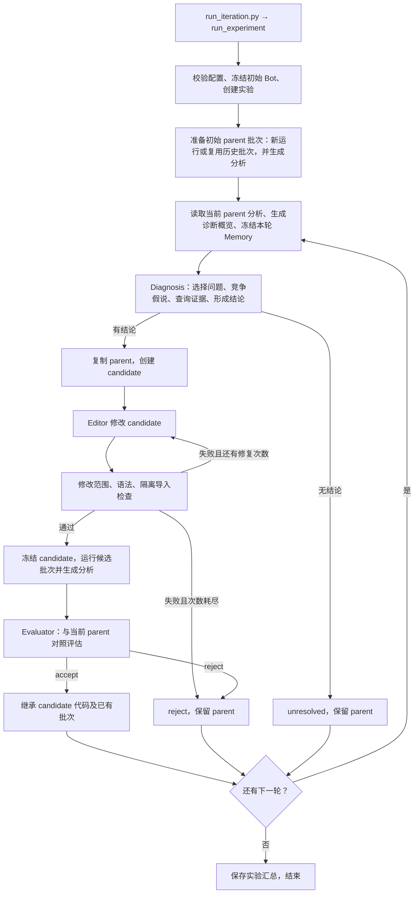

# SC2 RSI

面向持续代码进化的 StarCraft II 规则 Bot 研究项目。Bot 在游戏内按规则运行；RSI 在对局之间分析证据、修改候选代码并进行固定对照。

RSI 新产物中的项目内路径统一使用相对项目根目录的 `/` 路径，例如 `runtime/rsi/experiments/<experiment>/iterations/<id>/iteration.json`；读取时由代码按项目根目录解析，不依赖终端当前目录。Editor 提示中的辅助文件路径相对候选工作目录，例如 `../sessions/diagnosis/investigation.json`。项目外的 Python、SC2 安装等路径保留绝对路径。已有历史产物不重写，旧绝对路径仍可读取。

控制台实时显示对局结果、Diagnosis 的问题/假说/查证目的/工具退回与结论，以及 Editor 的文件操作和检查结果；评估保存胜率和核心指标的父子结果。长内容只显示摘要，完整对话、证据及 SDK 诊断日志保留在对应会话文件中，实验汇总写入 `experiment.json`。

控制台固定文案使用英文；显示内容解析或写入失败时跳过该条提示，不中断 RSI 会话。SDK 参数校验错误继续按原流程反馈给模型纠正，原始对话和用量记录照常保存。

## 目录

```text
bot/                          # 模块化规则 Bot
  components/                 # behaviors / tasks / tactics，可编辑业务边界
  core/                       # 调用、单位归属与动作仲裁
  spatial/                    # 地图、路径与选址
  telemetry/                  # 原始游戏日志
runner/                       # Bot/RSI 共用的单局、批次、版本、进程与产物工具
rsi/
  run.py                      # 顺序执行、预算和阶段产物
  analyzer.py                 # 日志指标、事件与静态分析结果
  retriever.py                # 统一查询分析数据、原始日志和冻结参考资料
  diagnosis/                  # 诊断工具组装、竞争假说与证据更新
  editor.py                   # 候选代码修改与编辑工具边界
  evaluator.py                # 固定对照与版本判断
  experiments.py              # 诊断消融与固定证据包
  tools/                      # 对局、验证、快照、模型会话接入
  memory.py                   # 文件化经验记录
  config.json                 # RSI 预算、实验配置与验收规则
environment.json              # SC2 路径与版本
pyproject.toml                # Python 版本、依赖与安装配置
knowledge/                    # 游戏机制、单位、能力、升级与科技树
scripts/                      # 独立 Bot、环境检查、知识导出与测试
  test/                       # Bot / RSI 离线测试和手动 SC2 烟雾检查
run_iteration.py              # RSI 根目录入口，转调 rsi.run
runtime/                      # 运行产物
  bot/<id>/                   # 独立 Bot 对局
  rsi/versions/<hash>/        # 冻结 Bot 快照
  rsi/experiments/<id>/       # 一次命令对应一个实验
    experiment.json          # 唯一实验配置、各轮简短索引、当前版本/批次及总消耗
    context/                 # 本实验共用的冻结 Knowledge / SC2 API
    iterations/<id>/
      iteration.json         # 本轮阶段、状态、版本、费用和产物路径
      memory.json            # 本轮开始诊断时冻结的精简历史经验
      overview.json          # 诊断任务摘要
      validation_0.json      # 各次静态验证结果
      evaluation.json        # 本轮详细评估
      patch.diff
      candidate/             # 可写候选工作目录
      sessions/diagnosis/    # job、调查记录、response、用量、SDK 对话和进程日志
      sessions/editor_0/     # job、response、用量、SDK 对话和进程日志
      batches/<id>/
        batch.json           # 对局条件、结果和单局路径
        analysis.json        # 批次统计和单局分析路径
        <run>/               # manifest、trace、result、analysis、录像和进程日志
    memory/                  # 本实验各轮开发经验
```

测试统一位于 `scripts/test/`；RSI 配置统一使用 `rsi/config.json`，环境配置保留在 `environment.json`。

## 环境准备

使用 Python 3.12，在项目根目录执行。已有 `sc2rsi` 环境可以直接复用：

```powershell
conda activate sc2rsi
python -m pip install -e .

# 首次配置：填写 .env 中的 LLM_MODEL、LLM_BASE_URL、LLM_API_KEY
Copy-Item .env.example .env
```

修改 `environment.json` 中的 SC2 路径与版本以匹配本机安装。环境检查入口为 `python -B scripts/check_environment.py`，不会启动对局或调用模型。

项目依赖统一写在 `pyproject.toml`，直接依赖固定版本；传递依赖由安装器解析。`.env`、编辑器设置、缓存和实验产物均由 `.gitignore` 排除。

## RSI 执行流程

一次实验按指定轮数顺序执行。初始 parent 对局只采集一批，也可通过 `parent_batch` 复用已有批次；后续各轮使用当前 parent 已保存的分析与对局结果。



静态检查失败时在同一个 candidate 目录中修复；检查通过后每轮只运行一个候选批次。接受后直接复用 candidate 的结果作为下一轮 parent，拒绝或无结论时继续使用原 parent。基础设施故障、日志不完整、模型会话失败或用户中断会保存状态并停止实验，不进入图中的下一轮；candidate 的 Bot 执行错误则按拒绝处理。

## 运行

```powershell
conda activate sc2rsi

# 查看参数，不启动游戏或模型
python -B run_iteration.py --help

# 从当前仓库 bot 开始，运行 5 轮；会启动 SC2 并调用配置的模型
python -B run_iteration.py --rounds 5

# 从指定快照开始；默认 1 轮
python -B run_iteration.py --parent runtime/rsi/versions/<hash> --rounds 5

# 其他设置统一放在 config
python -B run_iteration.py --config rsi/config.json --rounds 5

# 独立 Bot
python -B -m bot.run --time-limit 150

# 离线检查，不启动游戏或付费模型
python -B -m unittest discover -s scripts/test -v
```

独立 Bot 与 RSI 共用 `runner.matches.run_match`，每局在独立进程中运行，统一保存 manifest、标准结果和 Replay。独立入口可用 `--wall-timeout` 设置现实时间上限（默认 600 秒），`--no-log` 只关闭遥测。基础 API 和产物字段见 [Runner](runner/README.md)。

- RSI 只有完整进化流程；入口参数为 `--parent`、`--rounds`（默认 1）、`--config`。默认从当前仓库冻结初始 Bot，不读取历史全局版本指针。接受后继承 candidate；拒绝后保留 parent，轮数表示尝试次数。
- `--config PATH` 指定实验配置；模型读取 `.env` 中的 `LLM_MODEL`、`LLM_BASE_URL`、`LLM_API_KEY`，不把密钥写入产物。
- `parallel_matches` 同时决定每批局数和并发数，默认 5；seed 自动生成 `1..parallel_matches`，parent 和 candidate 使用同一组，不单独配置 `batch`。初始 parent 采集一批，之后每轮只跑 candidate 一批；接受后它的现有结果直接用于下一轮诊断与比较，不重跑 parent，也没有额外验证对局。启动提交间隔 3 秒以分散客户端加载峰值。日志复用 Bot Logger；Analyzer 只生成静态分析结果，Retriever 统一提供 `overview / metrics / events / trace / compare` 日志查询和源码、API、Knowledge、Memory 检索。时间窗口使用游戏秒。
- Retriever 默认返回摘要，`detail=raw` 获取采样、Trace 状态或详细统计。`next_offset` 表示可翻页，`truncated` 表示内容被省略；日志引用保留在条目内，完整证据留在分析产物中。参考读取直接返回路径、行号或 key 及内容，失败统一返回 `error={code,message}`。
- 诊断问题使用 `{problem, evidence}`，证据列表以自然语言说明 Run、指标与时间段、事件或参考资料。假说使用 `{id, explanation, predictions:{support,refute}, code_targets}`；问题核心在查询后固定，证据说明可以更新，假说可附理由新增或修订，旧版本自动归档。
- 自主查询分为 `query_logs(kind, purpose, params?)`、`read_reference(path, lines?, key?)`、`query_memory(text?)`，与 `select_issue`、`conclude` 一起组成五个诊断工具。日志查询单批次时自动补 `batch_id`，默认全部对局与时间。资料路径以 `source/`（父版本 `bot/`）、`api/` 或 `knowledge/` 开头；文本按 1-based 行号读取，每次最多 120 行，复用 SDK 的只读文件读取方法；JSON 用 `key`（支持点分隔）定位，不传则列出条目。Memory 按文本匹配本轮冻结经验。三类查询共用预算，记录统一保存为 `{tool, arguments, result}`；模型自主回顾和完善假说。
- 结论只包含 `{change, preserve, verification, code_targets}`；`verification` 是自然语言核实建议，不转换成局部指标硬门槛。代码目标采用项目相对文件路径或 Python 模块名，可用 `::Class.method` 指明符号；提交时检查文件、符号及可编辑范围。无可执行建议时调用 `conclude(reason=...)`，程序按 `unresolved` 结束。
- `overview.json` 保存诊断的核心任务数据：`runs / events / paths / limits`，包含对局条件、常用指标及每局各类诊断事件的首次发生。该对象原样作为会话 `job.json` 的 `task` 保存并拼入 Prompt，不再维护另一份展示格式。Bot、Knowledge 的简短说明直接拼入角色上下文。
- Editor 接收 `issue / hypotheses / conclusion / paths / validator_feedback`，同样保存并直接发送 `job.task`；`paths.evidence` 直接引用 `sessions/diagnosis/investigation.json`，其中 `queries` 保存完整查询记录。会话 response 引用调查结果，不再复制完整调查内容。`read_reference` 读取本实验共用的冻结 API/Knowledge，`source/` 指向当前候选 `bot/`。Memory 只保留问题、修改结论、验证/接受摘要及产物路径，不嵌套假说、查询和完整指标。
- `iteration.json` 只保存运行摘要和产物路径，完整诊断、验证、评估保存在对应阶段文件。诊断进程直接读取本轮已保存的探索分析结果，不重复计算指标和事件；Retriever 仅在概览、Trace 和跨批次对照需要时按需读取原始日志。磁盘日志及分析结果保留。
- config 的 `parent_batch` 可指向初始 parent 的已有 `batch.json`，默认 null；复用前校验版本、对局条件和记录身份，重新分析仅保存到新实验的 `batches/<id>/`，历史目录保持只读。批次分析只引用单局分析；实验内部直接复用已保存的分析。诊断的 Bot 说明读取冻结 parent。阶段开始、结束和失败统一更新 `iteration.json`，不另存 started/final 文件。批次中断时取消排队任务并终止运行中的 worker 进程树，`batch.json` 保留已完成结果及取消记录。
- parent 和 candidate 对局共用 `matches` 中的时间限制，默认每局最多 1800 游戏秒、600 现实秒。对局为非实时运行，实际速度受机器负载与 Bot 单步开销影响。
- 预算按轮重置，一轮最多 24 局、7200 现实秒；模型累计输入与输出共享 150 万 Token 和 2 美元已知费用预算。每个会话最多 80 步、1200 秒，单次请求最多 180 秒、输出最多 8192 Token。费用未知时无法依靠金额限制精确封顶。
- LLM 请求遇到 SDK 识别的连接错误、超时、限流等暂时性错误时允许重试一次，最多尝试两次；不重启整个会话或实验。重试及等待仍受会话与整轮现实时间预算限制。OpenHands 1.41.0 的 `num_retries` 实际表示总尝试次数，因此设置为 `2`。
- `model` 保存公共 LLM 设置和整轮预算，`model.diagnosis`、`model.editor` 分别覆盖角色参数；空对象表示继承公共设置。可分别设置 `model / base_url / api_key_env / reasoning_effort / temperature / top_p / top_k / seed` 及输出、步数、超时限制；未指定的模型和地址回退到 `.env`。默认 `reasoning_effort=high`，采样参数使用模型默认值，SDK 按模型能力转换或剔除参数。角色预算不能突破整轮 Token/费用上限。每个会话的 `job.json` 保存实际请求配置，`llm.json` 保存 SDK 构造后的配置（不含密钥）；服务端实际支持情况仍需实测。单会话费用上限复用 SDK `max_budget_per_run`，按已报告费用在步骤间检查，可能超出一次请求的费用。只有 SDK 正常完成的会话返回 `ok`，其他结束状态与错误原因保存到响应中。
- Diagnosis 使用单一 OpenHands 会话；Editor 复用官方文件编辑器和 `TerminalTool`，可在候选目录内执行离线检查并修复。终端使用当前 Python 环境，Windows 使用 PowerShell；Bot 测试位于候选目录外的 `scripts/test/`，通过候选 `PYTHONPATH` 检查候选代码。仅允许修改 `bot/components/{behaviors,tasks,tactics}/` 中的 Python 文件，静态检查与 candidate 对局仍由 Run 执行，接受后才更新本实验的当前版本。
- config 只保留常用实验设置、运行预算和 LLM 参数。接受规则及五项指标固定在 `evaluator.py`，Analyzer 阈值保留在 `analyzer.py`，诊断返回条数和长度限制保留在 `diagnosis/investigate.py`。评估结果仍保存实际使用的规则和各指标数值。
- 接受规则：胜率严格提升就接受；胜率下降则拒绝；持平时，五项中至少三项相对提升 5% 才接受。不另加绝对阈值或退步否决规则。parent 为零、candidate 为正值算提升；缺失或持平不算提升，缺失项仍计入总项数。平局及游戏时间上限按未胜计。
- 五项指标为：敌方单位与建筑击杀总价值 `combat_value`、击杀价值占击杀加己方损失价值的比例 `trade_efficiency`、平均现存军队价值 `army_value`、累计军队投入 `army_investment`、平均每分钟采集资源 `resource_collection_rate`。统一按矿物加瓦斯估值，军队使用原生 army 分类。交换效率无交战时为零；5% 指相对提升，不是增加 5 个百分点。
- Logger 被动记录原生 `state.score`，敌方单位/建筑击杀和分类损失等原始字段以 `score.*` 指标保留。同 seed 双方按共同游戏时长计算过程指标，再按批次取均值；平均军队价值按时间加权。旧日志缺少 score 时不会补零，需使用带新记录字段的 Bot 采集基线，之后继续复用。
- 复用比较仍检查条件、环境、日志完整性和采样覆盖率。candidate 的 Bot 错误拒绝该版本；基础设施故障、日志不完整、模型重试后失败或用户中断会保存状态并停止实验。未得到诊断结论记为 unresolved，保留 parent 进入下一轮。每个实验独立保存记录与 Memory，版本快照继续按内容哈希共享。
- 历史 `runtime/rsi_v1/` 等运行产物保留原样，新产物写入 `runtime/rsi/`。

当前已通过针对性的离线检查；新版完整真实对局与付费模型迭代仍需实测。

离线测试覆盖 Bot 执行契约、RSI 证据边界、评估规则及模拟迭代；OpenHands 接入使用脚本化模型，不访问模型服务。单独运行 Bot 或 RSI 测试可使用 `python -B -m unittest scripts.test.test_bot -v` 或 `python -B -m unittest scripts.test.test_rsi -v`。

真实 SC2 烟雾检查需手动执行 `python -B scripts/test/check_match.py`，不会随离线测试启动。它检查客户端、基础生产与 Replay，不用于判断策略强弱。

## 参考

- [Bot 使用与接口](bot/README.md)
- [Knowledge 索引与来源](knowledge/README.md)
